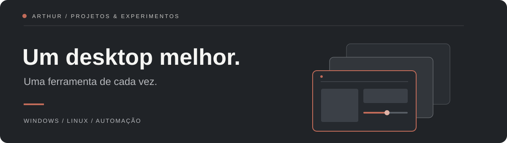

  

  <a href="https://arthurmpbby.github.io/">Portfólio ↗</a> &nbsp; / &nbsp;
  <a href="https://github.com/arthurMPBBY?tab=repositories">Todos os repositórios ↗</a>

## Software que resolve pequenas fricções.

Crio ferramentas para tornar o uso do computador mais direto: alternar janelas, controlar dispositivos e entender o que acontece na tela. Meus projetos passam por **Windows, Linux, automação e interfaces desktop**.

Prefiro interfaces claras, controle local quando possível e desempenho que possa ser medido — não só prometido.

### Em destaque

<table>
<tr><td colspan="2">
01 / DESKTOP · WINDOWS
<h3><a href="https://github.com/arthurMPBBY/YAHCW">YAHCW — um canto, tudo à mão ↗</a></h3>

Uma visão geral inspirada no KDE Plasma: janelas com prévias ao vivo, brilho do monitor e saídas de áudio, juntos na mesma tela.

<code>C#</code> <code>WinForms</code> <code>DWM</code> <code>Win32</code>

</td></tr>
<tr>
<td width="50%" valign="top">
02 / AUTOMAÇÃO · IOT
<h3><a href="https://github.com/arthurMPBBY/tuya-smart-lamps">Tuya Smart Lamps ↗</a></h3>

Controle local de lâmpadas Tuya, interface web, aplicativo de bandeja e integração com Android.

<code>Controle local</code> <code>SSE</code> <code>Android</code>

</td>
<td width="50%" valign="top">
03 / TELEMETRIA · LINUX
<h3><a href="https://github.com/arthurMPBBY/gaming-fps-hud">Gaming FPS HUD ↗</a></h3>

Monitoramento de desempenho e observação de apresentação Vulkan para Linux e KDE Wayland.

<code>C++</code> <code>Vulkan</code> <code>KDE Wayland</code>

</td>
</tr>
</table>

### Explorando em código aberto

Também experimento melhorias em projetos de terceiros. Estes PRs foram **encerrados sem merge**; são registros das propostas, não funcionalidades incorporadas ao upstream.

- **[Spotifast · letras sincronizadas](https://github.com/crmne/spotifast/pull/1016)** — apresentação das letras, estabilidade de layout e fundo da capa.
- **[Nuvio Desktop · reprodução no Linux](https://github.com/NuvioMedia/NuvioDesktop/pull/953)** — proposta de PiP, backend Vulkan e opções de upscaling.

---

Menos fricção no desktop. Mais espaço para o que importa.
